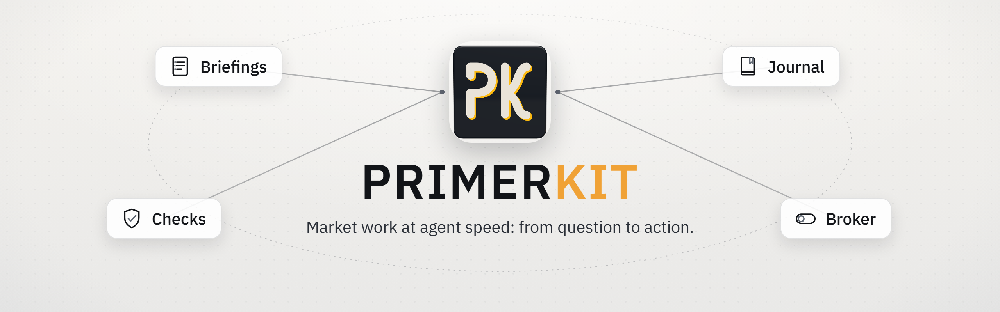
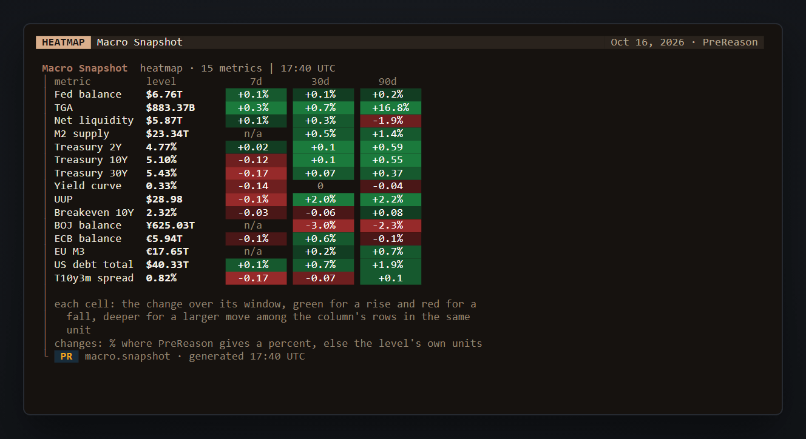
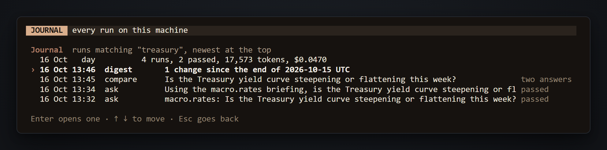
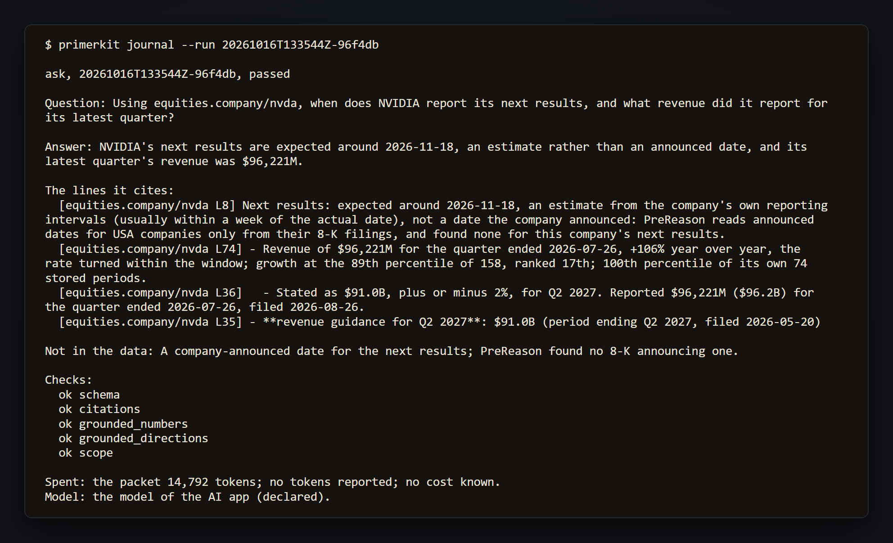
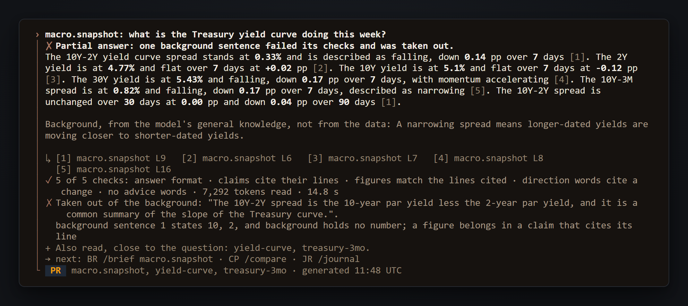
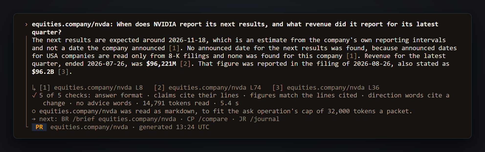
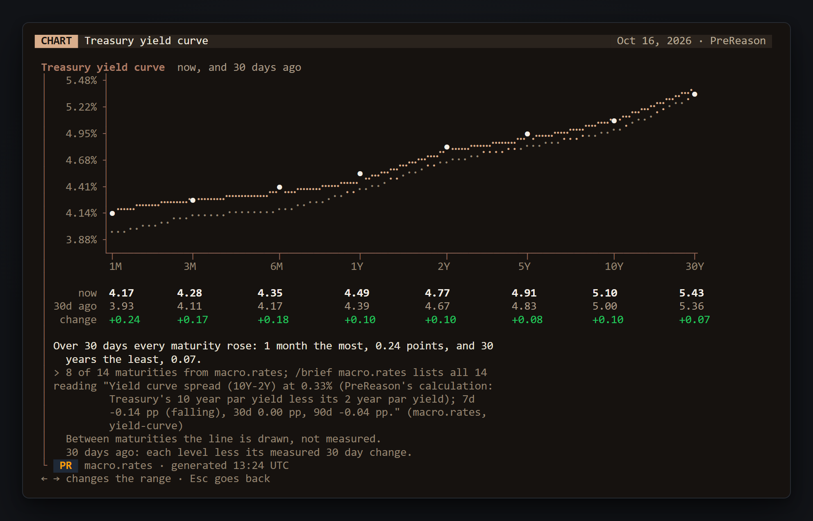
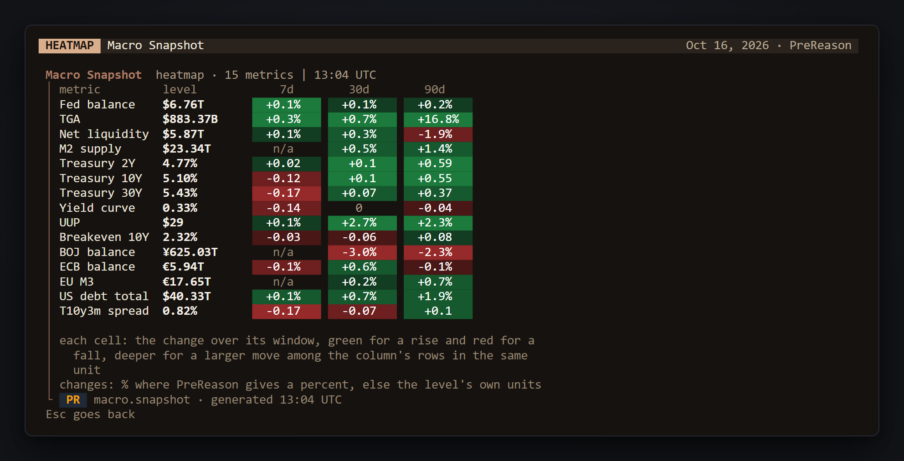

<h1 align="center">
  <picture>
    <source media="(prefers-color-scheme: dark)" srcset="assets/readme/hero-header-dark.png">
    
  </picture>
</h1>

<p align="center">
  <a href="https://www.npmjs.com/package/primerkit"></a>
  <a href="https://nodejs.org"></a>
  <a href="LICENSE"></a>
  <a href="https://www.prereason.com"></a>
</p>

**Market work at agent speed: from question to action.** Open source. primerkit hands your agent PreReason's current briefings with every line numbered, checks each answer against those lines in code, and keeps every run in a journal on your machine. Nothing here is investment advice: the model never proposes a strategy, and answers from the data or applies rules you wrote yourself.

<table>
<tr><td><b>The agent's own workplace</b></td><td>You pick where the model runs: an AI app you already use (such as Claude Code, on its own subscription), a hosted model on your own key, or a model on this machine (Ollama or LM Studio). primerkit's own session in a terminal (<code>npx primerkit</code>) draws the boards and charts; in Claude Code, Codex, Gemini CLI or LM Studio, your agent calls primerkit's tools as part of its own work.</td></tr>
<tr><td><b>Numbered data</b></td><td>PreReason's current briefings (or a past day's, when the question names one), with every line numbered. Each claim in an answer cites the numbered line it came from, and any background from the model's own knowledge is shown apart and marked as not from the data.</td></tr>
<tr><td><b>Checked answers</b></td><td>Checks run in code on every answer: its format, that each claim quotes the lines it cites, that each figure is in those lines, that a direction word such as rising or steepening cites a line that states a change, and a scope check for trade fields and advice words. There is one repair turn, and a claim that still fails is taken out and named.</td></tr>
<tr><td><b>A journal on your machine</b></td><td>Every run is kept on this machine with its question, answer, cited lines and checks, and its tokens and cost where its model reports them. <code>/journal</code> finds a run by words, briefing, outcome or day.</td></tr>
<tr><td><b>Routines and backtests</b></td><td>A routine is your own rules, in your own file, turned into one label for each run: logic tests on frozen days, backtests over a past window in three arms that differ only in their data, and a forward record that writes each label before its outcome exists. The model picks one of your labels; it never proposes a strategy.</td></tr>
<tr><td><b>/compare</b></td><td>One question answered twice on your hosted Claude model: once from PreReason's briefings, and once by the model's own web search with no briefings. It says what the run will spend before anything runs, shows the two answers side by side, and gives no verdict.</td></tr>
<tr><td><b>Brokers, with your approvals</b></td><td>Alpaca paper trading: each order waits for your <code>yes</code> typed at a terminal, under your own caps and a kill switch, and a standing exit you set is covered by the yes to its purchase. Robinhood live, through Robinhood's own server in your AI app: no code in primerkit sends a live order, and the trade skill asks your approval in primerkit before each one. primerkit cannot prevent an AI app from calling Robinhood's order tool without the skill, so keep Robinhood's trade approvals on. This is real money, and its losses are real. Nothing here is investment advice.</td></tr>
</table>

## Built from the data outward

<p align="center">
  <picture>
    <source media="(prefers-color-scheme: dark)" srcset="assets/readme/boxes-dark.png">
    
  </picture>
</p>

---

## Quick install

primerkit needs Node 22.12 or later.

1. **Run it.** The first run walks you through four steps, and each one says what you do and what primerkit does.

   ```bash
   npx primerkit
   ```

   - **Before you start:** the disclaimer. Enter agrees and starts.
   - **Step 1, the model:** pick where your model runs. It can be an AI app you already use (such as Claude Code, on its own subscription), a hosted model on your own key, or a model on this machine (Ollama or LM Studio). primerkit looks for each of these here, then checks that the model you pick answers and cites correctly.
   - **Step 2, PreReason:** it shows one link. Sign in, or create a free account with Google or GitHub (no card), and approve primerkit. The key is saved for you, so there is nothing to copy.
   - **Step 3, a first question:** pick one, or type your own. The answer cites its lines, and the checks run.
   - **Step 4, a morning digest:** choose a time, or not now. primerkit shows the entry it adds to your scheduler before it adds it.

2. **Or work inside your AI app.** Connect PreReason, then add primerkit's tools to Claude Code (or `codex`, `gemini`, `lm-studio`). The install shows what it would change, and changes nothing until you say yes.

   ```bash
   npx primerkit connect prereason
   npx primerkit install --host claude-code
   ```

To look around before you connect anything, `npx primerkit --demo` opens the same session on briefings PreReason saved on 2026-10-16, with no key and no model, and nothing is sent to PreReason.

The first run, step by step (drawn on those saved briefings, so nothing is sent):


Once it is set up, `npx primerkit ask "Is net liquidity rising or falling?"` asks one question from a terminal.

For the morning digest or a routine's daily run, install primerkit once with `npm install -g primerkit`, since npx keeps its copy in a cache npm may clear. On Windows, run primerkit from a folder of your own, such as your home folder ([Windows](#windows) says why). From a checkout: `npm ci`, then `npm run demo`.


## What you need

A key you already have set, such as `ANTHROPIC_API_KEY`, is found where it is. primerkit reads a key from its variable when a request needs it, sends it only to the service it belongs to, never prints it, and never writes it to its config or its journal.

- **A PreReason key**, for live briefings. The first run shows a link: sign in or make a free account, approve primerkit, and the key is saved for you (`primerkit connect prereason` does the same). Or set `PREREASON_API_KEY`. The demo, the model check and the benchmark need no PreReason key.
- **A model**, one of:
  - a local model, free: Ollama, LM Studio, or another server that speaks the OpenAI API and takes no key, such as llama.cpp or vLLM;
  - a hosted model on your own key, which the provider charges for:

    | Provider | Variable |
    |---|---|
    | Anthropic (Claude) | `ANTHROPIC_API_KEY` |
    | OpenAI | `OPENAI_API_KEY` |
    | Google (Gemini) | `GEMINI_API_KEY` or `GOOGLE_API_KEY` |
    | xAI (Grok) | `XAI_API_KEY` |
    | DeepSeek | `DEEPSEEK_API_KEY` |
    | Mistral | `MISTRAL_API_KEY` |
    | Groq | `GROQ_API_KEY` |
    | OpenRouter | `OPENROUTER_API_KEY` |

  - or an AI app you already use, on its own subscription: Claude Code, Codex, Gemini CLI or LM Studio.
- **Alpaca paper keys**, only if you want paper trading. You type them once at a terminal and they are kept in the system keychain; primerkit reads them from no variable.

## What it does

At home in the session, type a question, or type `/` for a menu of every command with what it does. The `primerkit ...` forms run the same thing once, from a terminal or a script.



- **Ask.** Type a question, or `primerkit ask "Is net liquidity rising or falling?"`. Up to three briefings or metrics are read, every line numbered, and the answer cites those lines. Five checks run in code, six on a dated answer: the answer's format, that each claim quotes the lines it cites, that each figure is in those lines, that a direction word such as rising or steepening cites a line that states a change, a scope check for trade fields and advice words, and on a dated answer, that it names that day. Name a day, such as `as of 2026-08-15`, to read the briefings as of then.
- **Companies.** Name a company by its code: `equities.company/nvda` (a US ticker or CIK), `equities.company/7203` (a Japanese code), `equities.company/005930` (a Korean code), or an Indian company's ISIN. A USA company's briefing needs a Basic key or above; a Japanese, Korean or Indian company's needs a Pro key or above. For example, a USA company, on a Basic key or above: `equities.company/nvda: revenue in each of its last 8 quarters?`
- **The news door.** What a company filed, and what federal agencies, Treasury and the Federal Reserve published, with the date of each: `equities.company/egp: what did it file in the last week?` or `What did the Federal Register publish this week?`
- **`/catalog`** (`primerkit catalog`): every briefing your key reads and PreReason's metrics, by area. `/catalog all` names every metric.
- **`/brief <briefing>`** (`primerkit brief macro.snapshot`): a briefing as a board, with each metric's level, its 7 and 30 day changes, and where it sits in its history.
- **`/chart`** (`primerkit chart <name>`): `yield curve`, `bitcoin`, `hashprice`, `etf flows`, `liquidity`, `treasury`, `correlations`, `market map`, `markets` (by asset class) and `positioning`. In the session, `/chart heatmap <briefing>` draws a briefing's changes as a heatmap, and `/chart <metric>` a dated line of any metric, such as `/chart gold`. Typing `/chart ` lists each one with its ranges.
- **`/journal`** (`primerkit journal`): every run kept on this machine, found by words, briefing, outcome or day (`/journal treasury`, `primerkit journal --search "yield"`). A run opens with its question, answer, cited lines, checks and cost.
- **`/positions`** (`primerkit positions`): your Alpaca paper holdings, where its mode reads, and every order intent with its state. Nothing on it sends an order.
- **The digest.** `/digest` (`primerkit run digest`): what changed in your watchlist since the last digest, one checked sentence for each change. The first run offers to run it each morning on this machine's scheduler; `/schedule` or `primerkit schedule 08:00` sets the time.
- **`/compare <question>`**: one question answered twice on your hosted Claude model, once from PreReason's briefings and once by the model's own web search with no briefings. It says what the run will spend before anything runs, about how many dollars at list prices, and gives no verdict.
- **`/bench`** (`primerkit bench`): the comprehension benchmark on your model. `/bench card` (`primerkit bench --card`) saves a share card on this machine.
- **Routines** (`/routine`, `primerkit routine new <name>`): your own rules turned into one label for each run, with logic tests on frozen days, a forward record kept day by day, backtests over a past window (`primerkit backtest`), and a research view that tests your written hypothesis in code. The model picks one of your labels; it never proposes a strategy.
- **Order intents and paper trading on Alpaca.** A routine's label can become an order intent (`primerkit routine <name> intent`), checked in code and placed on Alpaca's paper account only when you type `yes` at a terminal; a standing exit you set for it later sells without a second yes. primerkit's own orders are paper only. A live account, such as Robinhood's agent account, is reached by your AI app through the broker's own server: see [Live trading](#live-trading), and keep the broker's trade approvals on.
- **Inside Claude Code, Codex, Gemini CLI or LM Studio.** `npx primerkit install --host claude-code` (or `codex`, `gemini`, `lm-studio`) shows what it would change, and changes nothing until you say yes. The app's model writes the answer; primerkit prepares the packet, checks the answer and keeps the run.

Not yet: automatic orders of any kind, the news door inside AI apps, and connecting Alpaca from inside the session.

## Try the local models yourself

A local model costs nothing, and the model check and the benchmark need no PreReason key: they run on briefings saved inside primerkit. With Ollama:

```bash
ollama pull qwen2.5:7b
npx primerkit model check --ollama qwen2.5:7b      # about 5 calls: the verdict, reading, context and speed
npx primerkit bench --ollama qwen2.5:7b --runs 1   # 15 packets of ten questions; leave out --runs 1 for 45
npx primerkit bench --card                         # a share card of that run, saved on this machine
```

`--ollama` uses a model Ollama already has and never pulls one, so pull it first (the session's model step pulls a name you type, with its progress).

With LM Studio, or another server that speaks the OpenAI API and takes no key, load the model there and name it:

```bash
npx primerkit model check --server 127.0.0.1:1234/v1 --model <id>
npx primerkit bench --server 127.0.0.1:1234/v1 --model <id> --runs 1
```

The check ends with "fit for everything", "fit for ask and digest only" or "not fit", and the reason. The benchmark gives, for markdown, for JSON and for no data at all, the share of answers right and the right answers per 1,000 tokens, scored by code with no model judging.

How local models fare on primerkit's benchmark is coming: the model, the machine, its verdict and the seconds per answer. Run the check or the benchmark on yours, and post what you found as an issue on this repository.

## What leaves this machine

| To | What | When |
|---|---|---|
| PreReason's API | a briefing id (for a company briefing, with the company's code in it; for a question about its figures over several periods, its statement history, with `history=true`), a format and a date, or a metric id; the key; `User-Agent: primerkit/<version>` and `X-PreReason-Client: primerkit` | for each briefing or metric a question, a digest, a board, a chart, a routine's test day, a backtest's day or a forward record's run reads, and once when you connect, to learn the key's tier |
| PreReason's news door | a kind (filed or official), a company's code for its filings, a window of days and a limit of 25; the key and the same two headers. Never the question's words | when a question asks what was filed or published, one call each |
| PreReason's catalog and list of metrics | the request and the same two headers, with no key; while primerkit keeps no tier for your key, one read of the catalog carries the key, to learn it | when the connect step opens, when a question needs the list, on `/catalog`, the first time the menu lists `/brief`'s briefings, and on `primerkit doctor` |
| PreReason's bridge | its claim request, naming primerkit | once, when you connect |
| PreReason's price history | a from and a to date; the key | for `/chart bitcoin`, once for each routine test day, once each time a backtest's plan is drawn (to learn the key's tier) and once more for the window's closes when it starts, and once for each forward record run |
| a local model: Ollama, LM Studio or a keyless server | the packet: the primer, the question and the numbered lines, and for a routine your rules and its position | for each question, digest, check, benchmark and routine run; it runs on this machine, or at the address you give |
| a hosted provider, on your key | the packet; with a hosted model, the question with the list of briefings and metrics, so it can pick what to read; a request for its model list | for each question, digest, routine run and backtest tick, once you say yes to it, the benchmark on `/bench yes` or `primerkit bench --yes`, a backtest's three memory questions, the fitness check, and when you pick one of its models |
| Anthropic, for `/compare` | the question, sent to your Claude model with Anthropic's web search tool and no briefings, so Anthropic runs up to 5 searches built from it; the briefing side is a packet as above | only on `/compare`, after it says what the run will spend and you press Enter |
| Ollama's library | the name of a model you asked Ollama to pull | when you type a name in the session's model step (the demo's too) that Ollama has not got |
| npm | package downloads | for `npx primerkit`, at install, the first time the bridge runs, and when an AI app starts primerkit's server through npx |
| Alpaca's paper API | your paper keys, in Alpaca's own headers; account and position reads; a symbol's entry in Alpaca's asset list, when an intent is checked or an order is typed; an order you said yes to, and its standing exit; a cancel you asked for; reads of the orders primerkit placed, by their ids | only while Alpaca is connected and its mode is not `off`, and an order only on your yes at a terminal |

Every request to PreReason is built from identifiers and dates that pass an allowlist, so no question, answer, primer or journal entry is ever sent there; a company briefing's id carries the company's code and nothing else. There is no telemetry.

## What stays on this machine

Everything primerkit keeps is in one folder, `~/.primerkit` (or the folder `--home` or `PRIMERKIT_HOME` names). No key is written to any file in it.

```text
~/.primerkit/
  config.yaml                       your model, PreReason's tier, the watchlist and your settings
  journal/<day>/<kind>/<run>/       every run: the packet, the replies, the checks and the view you read
  journal/<day>/intent/<id>/        each order intent: its checks, your yes and the broker's answers
  snapshots/<briefing or metric>/   each briefing and metric, as PreReason served it
  digest/                           the last digest, which the next one compares with
  cache/                            PreReason's catalog and list of metrics, kept five minutes
  cards/                            the share cards you save
  routines/<name>/                  your routines: rules, tests, hypothesis, backtests, forward record
  broker/alpaca.jsonl               every check and step of an Alpaca order
  broker/STOP                       while this file is there, no order goes
```

Keys live elsewhere: PreReason's, once you connect, in PreReason's own file, `~/.prereason/credentials.json` (or the file `PREREASON_CREDENTIALS_FILE` names); Alpaca's paper keys in your system keychain; a model key in its own variable.

## Disclaimer and licence

This software runs on your machine with a model you choose. Your model and your rules make every decision. Nothing here is investment advice. PreReason, the default data connection, publishes general market briefings, the same for everyone on the same plan, and never sees your questions, answers, holdings or orders. Broker connections stay off until you turn them on, and Alpaca is connected on paper only.

primerkit is under the Apache License 2.0: see [LICENSE](LICENSE) and [NOTICE](NOTICE).

---

The sections below are the full detail, for when you need it.

## The session

- `npx primerkit` opens the session. The first start shows the welcome with the disclaimer, then the first run: the model, connecting PreReason, a first question, and the morning digest. Later starts open the home screen, where a typed question asks the briefings.
- **The command menu.** Typing `/` at home lists every command under the input with what it does, and the list narrows as you type. The arrow keys move through it and Enter runs the row, so nothing has to be remembered; `/chart`, `/brief` and `/routine` open a list of their own: every chart and range, every briefing your key reads by its name, or each of your routines with what it can do. `/compare` waits for you to type the question. Tab puts a row in the input without running it, and Esc closes the list. A command typed in full, such as `/chart yield curve 2025-09-26`, runs as typed.
- **The journal** keeps every question, digest, model check, compare and benchmark in `~/.primerkit/journal`, one folder per run with the packet, the replies, the checks and the view you read. No file in it is written twice. A question, digest, model check or compare stopped with Ctrl+C keeps nothing, and so does a benchmark stopped in the session; `primerkit bench`, a routine's logic tests and a backtest keep what ran. `/journal` lists the runs and opens one. Each run's `meta.json` keeps the tokens the model reported and, where its list price is known, the cost (a model on this machine costs nothing; a run answered inside an AI app reports no tokens to primerkit), beside the packet's own token count. `primerkit journal` lists the runs with them, `primerkit journal --summary` sums them by day, and `--json` gives either to a script. Every briefing a question, digest, board or chart reads is kept as served in `~/.primerkit/snapshots`; a routine's test and backtest days are kept in its `fixtures` folder.
- **The demo** (`--demo`): the same session on briefings PreReason served on 2026-10-16, answered by a stand in, with no key and nothing sent to PreReason or kept. Its model step also lists the local models and AI apps it finds; a local model chosen there runs a real fitness check on this machine, and choosing an AI app shows what its install would change and changes nothing. Bitcoin's chart, the market map and positioning are not in it, since the saved briefings hold no price history and no metric read on its own.
- `--home <folder>` (or `PRIMERKIT_HOME`) keeps primerkit's files in that folder for the run, in place of `~/.primerkit`. `primerkit doctor` checks Node, the model, the last check's verdict, the PreReason key and tier, PreReason's catalog and the schedule.





## Models and keys

- **Your choice of model.** A local model on Ollama or on another server that speaks the OpenAI API and takes no key, such as LM Studio; Claude, OpenAI's GPT models, Gemini, Grok, DeepSeek, Mistral, Groq or OpenRouter on your own key; or any model by the name you type. In the session's model step, a name typed for Ollama that Ollama has not got is pulled first, with its progress (Esc stops it); `--ollama` and `primerkit model set --ollama` never pull.
- **The fitness check** runs when a model is chosen: whether it answers in the right shape, whether its quotes match the lines they cite, a slice of the comprehension benchmark in markdown and in JSON (which proposes the packet format for that model), the context against the largest packet in use, and its speed. It reads briefings saved inside primerkit and makes no PreReason call. The verdict is "fit for everything", "fit for ask and digest only" or "not fit", with the reason.
- **What a hosted run costs is shown as packets and tokens.** When you choose a hosted model in the session, its fitness check first says how many packets and tokens it will send and waits for Enter (`s` skips it). `/model check` runs it again at once, and `primerkit model check` runs it after one line naming the provider. The benchmark, a routine's logic tests, a forward record run and a backtest on a hosted model say what they will send and run only on your yes (`/bench yes`, `--yes`). None of these shows a dollar figure: only `/compare` gives one, an estimate at list prices, before it runs.

A key is read from its variable when a request needs it and sent only to that provider. It is never written to the config or the journal. The session lists a provider's models by asking the provider with your key.

A local model costs nothing and its packets stay on this machine. Ollama starts at its own default context of 4,096 tokens and is asked for more only when a packet needs it, up to what the model was trained for and this machine's memory can hold, at most 32,768; `max_context` for the model in `~/.primerkit/config.yaml` sets it by hand. A server that speaks the OpenAI API is asked what context it loaded the model with, where it can say; a model LM Studio has not loaded yet is given the 4,096 tokens a model loads with by default, until it has been loaded. Its address may be given as `127.0.0.1:1234/v1`, and is read as `http://127.0.0.1:1234/v1`. Such a server is sent no key.

`--ollama <model>`, `--server <url> --model <id>` and `--provider <id> --model <id>` work on `ask`, `bench`, `model check`, `routine test` and `backtest`, for one run, and on `model set` to keep the choice. They go together as written: `--model` alone names no model, and the command says so rather than run on the model already set. A flag that takes a value never takes the next flag as one.

## Asking

- **The `ask` operation.** Up to three briefings or metrics are read for a question: the ones it names, with any that match it closely, or the closest matches from the catalog of briefings and PreReason's list of metrics. A hosted model picks them, with one more call; a local model's are picked by the question's words. A metric is read as it stands now, as numbered lines cited like a briefing's (`[treasury-10y L2]`). Every line is numbered, and the model answers in JSON that cites those lines.
- **The checks.** Five run on every answer, and a sixth on a dated one (see One past day): the schema; the citations (each claim quotes the line it cites); grounded numbers (each figure in a claim is in the lines it cites, and a figure written with a sign, such as +2.5% or -0.12%, fails where they give it with the other sign); grounded directions (a claim with a direction word, such as rising, falling or steepening, or a move said with its figure, such as up 2.5% or a 2.5% fall, cites a line that states a change, and not one that runs the other way, since a line that gives only a level shows no direction; accelerating or slowing cites the change over two windows; higher or lower may instead cite the two values compared); and scope, which fails a sentence with one of a short list of advice phrases, or more than four background sentences. A field a trade would need (such as action, side or size) fails the answer: the answer's format allows none, and the scope check refuses one wherever a format would let it through. The scope check looks for advice words; it cannot prove an answer holds no advice. The direction check, in the same way, looks for a list of direction words. There is one repair turn, and a claim that still fails is taken out and named. The line under each answer names the checks that passed.
- **Background.** Where a question reaches past the data, the answer may add up to four sentences of background from the model's general knowledge. Background holds no number and no advice phrase, and is shown apart, marked as not from the data.
- **One past day.** A question that names a day, such as `as of 2026-08-15`, `on Aug 15, 2026` or `on Aug 15` (the latest one not after today), reads the briefings as of that day, with `date=`: only the periods released by then, each figure saying when it was public or that it may be a later revision (PreReason's own words). Code reads only such exact dates; a hosted model may name the day for words such as "last Friday", and inside an AI app the app's model passes it. The answer names the day (the screen prints it as "as it stood on Aug 15, 2026"), and a sixth check holds its `data_as_of` to it. Two days, a day still to come or a day not on the calendar give a note in place of an answer, never an answer as of today. A metric is not read for a past day, since PreReason serves it as it stands now only; a question that would read only metrics gives a note. A day outside your key's window shows PreReason's own words, which name the window. A question with words such as "yesterday" and no day the model or the app names is read as it stands now, and the screen says how to name the day.

  Dated briefings keep payrolls, and the CPI's 12 month change not seasonally adjusted, as each release stated them back to 2003. Other revised series may be served as a later revision, and the answer says so. Check what your rules read on a past day before you trust a backtest window.
- **When nothing matches**, a short note names the few nearest briefings and metrics, and `/catalog` (`primerkit catalog` in a terminal) lists every briefing your key reads and the metrics, by area: the first eight of each area and how many more, and every one with `/catalog all` (`primerkit catalog --all`). The journal keeps, with each run, what was read, who picked it (you by naming it, the model, the word match or the AI app) and the day, in `pick.json`, and what the answer said the packet did not hold.
- **Packet fitting.** A packet too big for the model's context, or over the operation's own cap (32,000 tokens for ask), is fitted, and what was left out is named with the bound it was left out for: Ollama is given more context first, up to a cap; then markdown is read in place of JSON, the least relevant briefing first; then fewer briefings are read, and JSON is given back to those still read where it fits; then only the sections on the metrics the question names. A packet that still does not fit is not sent, and the screen says what context or cap it is over.



## Companies and the news door

- **A company's briefing.** `equities.company/<code>` reads one company's briefing: a US ticker or CIK (`nvda`, `0000320193`, `brk-b`), a Japanese securities code (`7203`), a Korean stock code (`005930`) or an Indian company's ISIN, in lower case. Only such a code can follow the slash, never words. A question that names a company reads what it names, up to three, and adds nothing close to it. A company's briefing that PreReason refuses for a past day is read as it stands now, with a note. A question about a company's figures over several periods (each of its last quarters or years, the same quarter a year earlier, a trend) reads its statement history in place of the whole briefing: PreReason's numbers block with its quarters and fiscal years, today only; where PreReason holds no history for that company yet, the whole briefing is read and a note says so. Every other `equities.*` briefing is refused, and so is `equities.company` alone, which names no company.
- **The news door** is PreReason's dated record of what the companies it covers filed and what federal agencies, Treasury and the Federal Reserve published. A question that asks what was filed or published, and when, reads it in place of the briefings, one call. A company's filings are read by its code, so name the company as `equities.company/<code>` in the question. There is no search by words: a read names a kind, a company where it is a filing, and a window of days. The window is the span the question names by its dates ("between September 28 and October 9"), at most 92 days, or the one day it names. A question that names no day, or a span in words such as "the last 30 days", reads PreReason's own 7 days ending today, and the answer's credit line names the window read. Up to 25 records are read, newest first, each a numbered line with its date, who filed or published it, what it is and its source, and the answer cites them as any answer does. A window that holds no record asks no model, and says what was read. PreReason reads no filings for Indian companies yet. The demo holds no news, and inside AI apps the news door is not read yet.



## Inside Claude Code and other AI apps

You do not need primerkit's session open for this. Once installed, your agent in Claude Code, Codex, Gemini CLI or LM Studio calls primerkit's tools as part of its own work. It asks for the briefings and metrics a question needs and gets them with every line numbered. It writes its answer in the form primerkit gives, and primerkit's code checks each claim against those lines, gives the agent one repair turn, and keeps the run in your journal. The same tools run the benchmark and a routine's backtest a tick at a time, and the trade skill records an order you typed as an intent that waits for your yes. To see the data for yourself, `npx primerkit` in a terminal draws the boards and charts, and opens every run your agent made.

```bash
npx primerkit install --host claude-code
npx primerkit install --host codex
npx primerkit install --host gemini
npx primerkit install --host lm-studio
```

In Claude Code the plugin does the same: `/plugin marketplace add KalskiTheDan/primerkit`, then `/plugin install primerkit@primerkit`. In LM Studio (0.3.17 or later), a model that can use tools calls primerkit, and LM Studio asks you before a call, until you tell it to always allow that tool.

`primerkit install --host claude-code` shows what it would change: it adds primerkit's local server to Claude Code (`claude mcp add --scope user primerkit`) and writes four skills to `~/.claude/skills`. In a terminal it then asks, and makes the changes on your yes; in a script, `--yes` says it. Nothing else in Claude Code is touched. `--host codex` and `--host gemini` do the same for Codex (`~/.codex/config.toml`, `~/.agents/skills`) and Gemini CLI (`~/.gemini/settings.json`, `~/.gemini/skills`), and `--host lm-studio` adds the server to LM Studio's `mcp.json` (`~/.lmstudio/mcp.json`; LM Studio has no skills folder). Run again after an upgrade, it replaces the launch line it wrote for Codex, Gemini CLI and LM Studio, and keeps anything you added to primerkit's entry (Claude Code keeps the one it has: `primerkit uninstall --host claude-code` first). `primerkit uninstall --host <app>` takes out exactly what was put in, whatever version wrote it.

Run through npx, the install tells the app to start the server through npx at this version (`npx -y primerkit@0.1.0 mcp`, through `cmd.exe /c` on Windows, with `cmd.exe` named by its full path), since npx keeps its copy in a cache npm may clear. The app finds `npx` itself as it finds any command, from the folder it starts the server in. Installed with `npm install -g primerkit`, or from a checkout, it gives the app primerkit's own path.

The skills are named `primerkit-ask`, `primerkit-digest`, `primerkit-bench` and `primerkit-backtest`, so they never write over a skill of your own; the install stops before changing anything if a folder of that name is not primerkit's. In Claude Code, type `/primerkit-ask` with your question.

The server, `primerkit mcp`, has eleven tools and four prompts (ask, digest, bench and backtest). `prepare_operation` reads the briefings and metrics the app's model picks (at most three), as of the one past day it passes as `date` where the question asks about one, and returns the numbered packet, and keeps the run in the journal as pending; `submit_response` checks the app's answer, gives one repair turn, and keeps the run with its view (a call with no answer records nothing); the packet is fitted to the operation's own cap here too, and one still over it is not handed out; `bench_next` and `bench_record` hand the benchmark's packets to subagents; `backtest_next` and `backtest_record` do the same for a routine's backtest, one tick at a time; `list_operations` and `journal_read` say what there is; `status` reads, and changes nothing, the model, PreReason's tier, each broker's connection and mode, and today's runs with their tokens and cost; `catalog` searches the briefings and metrics this key reads; `intent_record` keeps a Robinhood order intent in the journal as pending, for the trade skill ([Live trading](#live-trading)), and sends nothing. Each result carries a JSON block beside its text, as a second text block: the run's id, the blocks read, the claims with the numbered lines each cites, each check passed or failed, and the tokens. An error carries its code: `tier_refused`, `rate_window`, `no_key`, `no_model`, `check_failed`, `bad_input`, `not_found` or `failed`. The server has no broker or order tool. `primerkit mcp --demo` serves the saved briefings. `hosts/claude-code-plugin` carries the same server and skills as a Claude Code plugin (there the skills keep their own names, ask, digest, bench, backtest and trade, under the plugin's name; trade does nothing until Robinhood's server is added), and the repository lists it as a plugin marketplace (`.claude-plugin/marketplace.json`). Installed from the marketplace, the plugin is copied on its own, so it starts the server from npm at its version.

## Boards and charts

- `/brief <briefing>`: each metric's level, its 7 and 30 day changes as PreReason measured them (`n/a` where it did not), 30 days from your journal, and where the level sits in its history. `/brief <briefing> fill` reads the days of the last 30 your journal lacks with `date=`, one call each.
- `/chart yield curve`: the Treasury curve now, against 30 or 90 days ago (each level less its measured change), a year ago, or any date (`/chart yield curve 2025-09-26`), read with `date=`. A Pro or Enterprise key reads macro.rates, which carries every maturity on Treasury's par yield curve, fourteen, today and on the date; the chart draws eight benchmarks (1, 3 and 6 months, 1, 2, 5, 10 and 30 years), each value under its point, the sentence under it counts the moves and names the largest, and `/brief macro.rates` lists all fourteen. A benchmark the read does not carry shows n/a. Below Pro the curve has five: 2, 10 and 30 years from macro.snapshot, and 3 months and 5 years from their own metrics, with each notice PreReason serves with them printed once under the board, as served; on a past date 3 months is the 10 year less the 10y minus 3M spread, and 5 years is missing. Between maturities the line is drawn, not measured. Under the levels, a change row gives each maturity's move between the two dates where both are read, coloured by its sign, and under the chart PreReason's own reading of the curve, where the read serves one, is quoted whole and cited to its briefing. Printed once, the curve needs a window about 52 columns wide (see Window sizes).
- `/chart bitcoin`: 30 days, 90, a year or all of PreReason's price history, or from a date, with its 200 day average from btc.momentum where the key reads it. The history has a point a day and ends with yesterday; the line ends on the price now, from btc.momentum, or from btc.quick-check below Basic, and that is the price the chart calls now. PreReason's closes come from more than one source over the years; where it names each close's source, the board names every source it drew, and shows the notice a source's terms ask for, such as "Powered by CoinGecko."
- `/chart hashprice`: from your journal; `/chart hashprice fill` reads the missing days with `date=`, one call each.
- `/chart etf flows`: the spot Bitcoin ETFs' latest day by fund, with the funds not named as the net less those that are, and 30 trading days in and out from your journal; `fill` reads the missing days.
- `/chart liquidity`: net liquidity as the sum it is, the Fed's balance sheet less reverse repo and the TGA, each with its 7 day change and its date, and 30 days of it from your journal.
- `/chart market map`: nine markets as of the read (SPY, QQQ, IWM, TLT, HYG, VXX, UUP, GLD and WTI oil), each metric's 7 day change as PreReason measured it, in equal tiles that are never sized or ordered by value. A tile is coloured by the change's sign alone, green for a rise and red for a fall, and a change of zero is muted; in colour the colour carries the sign, and plain text keeps the + and -. A tile whose newest value is older than the read names its own date, a metric the key cannot read says so, and the credit names each source PreReason serves for them. Under the board, each notice PreReason serves with the metrics is printed once, as served. Nine calls, one a metric. A key that reads each market's level alone, a Free key, is told before anything is read that the map needs a Basic key or above. A key PreReason does not accept, or its rate limit, stops the calls, and the chart says so.
- `/chart markets`: the markets by asset class, in the order equities, rates and credit, FX, commodities and energy, and crypto last. Each is a tile with its level and its 7 day change, green for a rise and red for a fall, deeper for a larger move within its group in the same unit; a rate's change is in percentage points (pp). The tiles are equal, since the metrics serve no size, and the legend says so. Eighteen calls, one a metric. `/chart market map` stays the nine tile map for a narrow window.
- `/chart <metric>`: a dated line of any metric from your journal, by its id (`/chart treasury-10y`) or a short name (`gold`, `oil`, `spy`, `uup`, `eurusd` and others). It shows the title and unit, the last value with its 7 and 30 day changes green or red by sign, the low and high, the source and its day, and PreReason's own sentence for the metric, cited. It finds the briefing on this machine that carries the metric, or reads the one named with `in <briefing>`. `fill` reads the missing days as far back as the key reads, one call each, and the arrow keys change the range (30 days, 90 days, a year).
- `/chart positioning`: SPY beside the CFTC's weekly noncommercial net position in E-mini S&P 500 futures, marked futures, with where it sits among the prior 26, 52 and 156 weekly reports, as PreReason ranks it, each dated by the day the CFTC released its report. It is futures positioning, not the exposure of any fund, and its line over time is marked futures too. Its heading names the time it was read, as the market map's does. Under the board, each notice PreReason serves with the metrics is printed once, as served, a notice for PreReason's own calculation apart from its publisher's. The lines over time come from the readings kept on this machine, which each read of the chart adds to, and say how many there are. Five calls.
- `/chart heatmap <briefing>` (or `/brief <briefing> heat`; macro.snapshot where none is named): a briefing's metrics against its 7, 30 and 90 day windows. Each cell is the change over its window as PreReason measured it, green for a rise and red for a fall, deeper for a larger move among the column's rows in the same unit; a change is in percent where PreReason gives one, else in the level's own units. Any briefing the key reads.
- `/chart treasury` and `/chart correlations`: Bitcoin treasury holders by type and size, and the correlations a briefing serves, with the briefing's own reading quoted whole and cited.

With a PreReason key the menu offers every chart, each one a Free key cannot draw marked with the tier that draws it, such as (Basic), as `primerkit --help` marks them. On a key whose tier is known, a chart above it is refused before any call, with that tier named, and `/chart bitcoin` draws as far back as the key reads: 30 days on a Free key. The arrow keys change a chart's range. Lines draw in braille with round points on the values named; the old console gets ASCII. `primerkit brief <id> [fill]` and `primerkit chart <name> [range]` print a board or a chart once.





## /compare

`/compare <question>` asks your hosted Claude model the question twice: once with PreReason's briefings, exactly as an answer is made at home, and once with Anthropic's web search tool and no briefings. Before anything runs it says what the run will spend: about how many tokens and up to how many searches (5) on your model key, about how many dollars at list prices, and how many PreReason calls on your plan. Enter runs it and Esc goes back. The two answers are shown side by side (stacked in a narrow window), each with what it read: the briefing side with its checks, the web side with the pages it cites and its figures not checked. primerkit gives no verdict. Both answers are kept in the journal.


*A run of 2026-10-16: one question, one run, both answers uncut.*

It runs only on a hosted Anthropic model whose list price primerkit knows, with PreReason connected; on a local model, another provider or the demo it says so in one line and nothing runs.

## The benchmark

`/bench` or `primerkit bench` reads the five free briefings PreReason served on 2026-09-25 in three ways (markdown, JSON, and no data at all) and asks ten questions of each, three runs apiece: 45 packets, scored by code. `--runs 1` to `--runs 5` sets the runs. It reports the share right and the right answers per 1,000 tokens for each. It makes no PreReason call. A hosted model runs it only after it says how many packets it will send (the CLI adds the tokens), on `/bench yes` or `primerkit bench --yes`. `/bench card` or `primerkit bench --card` saves a share card, a PNG and an SVG, in `~/.primerkit/cards`; nothing is uploaded. Ctrl+C on `primerkit bench` keeps what ran; a benchmark stopped in the session keeps nothing.

## Routines

A routine is your own rules, in your own file, turned into one label for each run, such as watch, enter or exit. primerkit ships no rules. `/routine new btc-rules` in the session, or `primerkit routine new btc-rules`, makes its folder in `~/.primerkit/routines/btc-rules` with four files:

- `routine.yaml`: the briefings it reads, as of the run; how many days of Bitcoin's daily price it reads (`price_days`, from 7 to 365, 200 unless you set another, enough for the research view's 200 day average); how often it runs, each day or each week; each label and what it holds; your estimate of a trade's cost, and of the spread in basis points (`spread_bps`, for the research view's costs); and, if you like, a model of its own. A label holds a target, the share of the account held long in BTC/USD from 0 (all cash) to 1, or `hold: true`, which keeps what is held. The target, the fee and the spread start as placeholders, since the sizes and costs are yours, and the model never sees them; a backtest waits until they are filled in, or until the spread's line is taken out.
- `rules.md`: your rules, in your own words; or name any file on your machine in `routine.yaml`. It starts as a comment with no rules in it, and until rules are written outside the comment, the routine returns `no_rules_defined` and asks no model.
- `tests.yaml`: its logic tests. Each names a day, what was held (flat, or long since a date at a price), the label your rules give that day, and, if you like, a block or a line the answer must cite.
- `hypothesis.md`: your hypothesis card, in your own words: the claim, the mechanism, the expected signature, the universe and horizon, and the success and kill criteria. It starts with a placeholder in every field and no example; [Research](#research) says what reads it.

**What your key reaches.** A free PreReason key reads the last 30 days, and a run counts back from yesterday's close, so on a free key set `price_days: 28`, as `routine.yaml` says; a new routine on a free key has 28 written in, and a run with more stops before any call. That reach leaves no room for a backtest window. A basic key reads from 2025-01-01, so with the default 200 days a backtest's first tick is 2025-07-20 at the earliest. Pro and Enterprise keys read all of it.

A run gives your model your rules as numbered lines, the briefings, a table of Bitcoin's daily closes with the change over the last 7 days, the change over the whole table and its high and low (measured in code, so the model is never asked to do the arithmetic), and the position. The model returns one label, the rule that gave it, and claims that cite the lines they rely on; a claim that compares the data with a rule cites both. The checks every answer passes run here too, and one more: the claims cite at least one line of the data, not your rules alone, and a label with a target cites the rule it applies. There is one repair turn, and an answer may never give a size, an amount or an order.

`/routine btc-rules test`, or `primerkit routine btc-rules test`, runs each test several times (`runs` in `tests.yaml`, 5 unless you change it), each a fresh call, and counts the runs that give a label the test expects. The data for a test's day is read once, as of that day, and frozen in the routine's `fixtures` folder, so every run of a test reads the same lines; delete a day's folder to read it again. A hosted model runs the tests only after it says how many packets it will send. The counts are kept in the routine's `results` folder, and every run is in the journal.

The logic tests check whether your model applies your rules the same way each time, not whether the rules would make money. A model can cite the right lines and still compare two numbers wrongly; every check passes such an answer, and only the label a test expects catches it.

`/routine btc-rules` shows what the routine reads, its model, its rules file and its labels, and `/routine btc-rules rules` the rules file and its last test.

### Backtests

`primerkit backtest btc-rules --from 2026-06-01 --to 2026-08-31` replays the routine over a past window, a tick each day or each week as routine.yaml's `every` says (or `--every day|week`), in three arms that differ only in their data: the treatment reads the routine's briefings as of that day, the control reads the price alone, and the placebo reads the briefings as of 150 days earlier, dated as if they were current, so the model cannot tell them from the treatment's by their dates. The same model, rules and dates run in each, so whatever the model remembers of the window it remembers in every arm, and the difference between the arms is what the data added.

Dated briefings keep payrolls, and the CPI's 12 month change not seasonally adjusted, as each release stated them back to 2003. Other revised series may be served as a later revision, and the answer says so. Check what your rules read on a past day before you trust a backtest window.

- **The plan comes first:** the ticks, the arms, the model calls, the reads from PreReason (and the days already kept), and the time it will take at the speed this model has shown here. A window your key's tier cannot read is refused: the first tick's price table has to fit inside the key's reach (see What your key reaches, above), and the placebo is left out where its days fall earlier. A backtest runs on whole past days, so a window ends yesterday at the latest.
- **The account** is a simulated $10,000, long or flat. A label's target moves it to that share of the account at the next day's close, with your fee taken off; a hold label keeps what is held, and so does a tick whose answer failed its checks twice. The model never sees a price after the day of its tick, nor a fill dated after it (where a day's close is missing, an order fills at the next close there is). A label is held to your own `max_position_share` in a terminal and inside an AI app alike. The prices are read once, in parts of up to 1,000 days, so a long window is read whole.
- **Every answer** passes the same checks as any other, with one repair turn, and is kept in the journal. The run's own record is in the routine's `backtests` folder, a line for each tick as it is done: Ctrl+C keeps what ran, and `--resume` carries on at the next tick, as long as the rules, `routine.yaml` and the model are the ones it started with.
- **The report** is drawn as primerkit's other charts are: each arm's account day by day against holding BTC/USD throughout, the treatment solid and the others dotted, each named at its end with its return; then each arm's return, its largest fall, its trades, its days in the market and its fees; the treatment against the control and against the placebo; and on how many ticks the data changed the label. `--reps 3` runs each arm three times over, with the placebo 150, 180 and 210 days stale, so one lucky run does not read as an edge. The plan and a stop for your yes are drawn the same way, and every one of them fits the window it prints in.
- **Drawn again:** `primerkit backtest btc-rules --replay` draws the newest finished run's report from its folder, with no model and nothing read (`--run <id>` picks another). In the session, `/routine btc-rules replay` shows it, and the arrows move through its ticks: the tick they are on is marked on the treatment's line, with what each arm did on it, and `d` shows that tick step by step, each arm's from the journal: what it read, the rules as read, what the model returned and cited, the checks, and what the account did.
- **A hosted model** starts only when you add `--yes`, after the plan says how many packets and tokens it will send to the provider on your key. Inside Claude Code, the `primerkit-backtest` skill hands each tick to a subagent with the model you pin, on your subscription. A backtest runs from a terminal or an AI app; the session draws a finished one.

#### What the model already knows

A model may remember what happened in a window its training reached, and a backtest of such a window measures its memory as much as the data. Three guards lower that leak, and every report says which applied. None of them removes it.

- **The cutoff.** primerkit knows how far the training of a few models reaches, each from its maker's model card, or from its release where the card states none. For any other model the memory check decides (below), and the plan and the report say so, with the closes it asked; or give the cutoff once from the model card, `--cutoff 2025-07`, and it is kept in `config.yaml`. A window that starts after the cutoff month is out of sample, and the report says so. A window that starts in that month or before it runs only with `--inside-training`, your yes, and every result from it says it is inside the model's training window.
- **The memory check.** Before the first tick, the model is asked Bitcoin's close on three days of the window (its first, its middle and its last) with no data at all. If two answers land within 5% of the close (every answer, in a window of one or two days), the model remembers the window, whatever the cutoff says: the run stops before any tick and goes on only with `--resume --inside-training`, labelled the same way. The three questions are three more model calls, and the plan counts them.
- **Dates as day numbers.** In every packet, a date is written as a day number from the window's first day ("day 41"), in the briefings, the price table and the position alike, and a briefing's own count of days (a streak's "day 26") is written "26th day", so a day number is always a date. Each briefing counts from the day it stands for and carries that day as its date, since PreReason builds a past day's briefing when it is asked for it; so the placebo's briefings, 150 days old, read as current ones do, and only their levels differ. Your rules stay as you wrote them. Prices and levels still hint at the period, so this lowers the leak and never removes it.

Inside Claude Code, `backtest_next` takes the same two answers as `cutoff` and `inside_training`, and hands out the memory check's three questions as packets before the first tick.

A backtest is a simulation on past data: it says nothing of what the routine will do next, and it is not advice.

### The forward record

`primerkit routine btc-rules track` runs the routine once now (with a hosted model it first says what it sends, and runs with `--yes`, or `/routine btc-rules track run yes` in the session), on the data as PreReason serves it at the run and the closes through yesterday, and writes its label to the routine's `forward` folder before its outcome exists. No order goes anywhere. The same simulated account as a backtest's scores it as closes arrive: each label's share fills at the first close after the newest close its run saw, and the record is drawn against holding BTC/USD since its first run. Each answer is in the journal.

- `--at 07:30` shows the entry it would add to the machine's scheduler (Task Scheduler, launchd or cron) to run it every day, and adds it with `--yes`; `--stop` takes it off, and the record stays. A scheduled run uses the routine's own model, else the one primerkit is set to; a hosted model runs on it only when you said yes to the daily packet as you added it.
- `--show` draws the record with nothing run. In the session, `/routine btc-rules track` shows it, and `/routine btc-rules track run` runs it once.

It is slow by nature, and the one record a model's memory cannot reach: every label in it was written before the day it is scored on.

### Research

**The model never proposes a strategy.** It picks one of your labels from your rules on each run, and nothing more: primerkit ships no rules and writes no hypothesis, and the card, the rules and the criteria are yours. Every screen below closes on the same line: *The model never proposes a strategy: it labels your runs, and primerkit's code checks your card's form. Every result here is from a simulated account: not a forecast, not advice.* None of them has an order, a broker or a ranking by return in it.

- **The card.** `/routine btc-rules hypothesis` (`primerkit routine btc-rules hypothesis`) shows your `hypothesis.md`, its version, its hash and when it was frozen. The card freezes at the routine's first backtest: it is hashed into the run, and kept as written in the routine's `hypotheses` folder. A change after that is a new version at the next backtest; every older version and its results are kept. The same words are the same card, whether saved with CRLF endings or a byte-order mark (as PowerShell 5.1 writes one). A routine made before cards gets the template the first time its card is shown, and an existing file is never written over.
- **The form check** is code, not the model, and reports per field only: stated or missing; for the criteria, whether they hold one number; for the signature, whether it names a series the routine reads (a briefing id it lists, or Bitcoin's price), naming any series it would need. It never rates a field and never suggests a mechanism, a threshold, a symbol or a horizon.
- **The ladder.** `/routine btc-rules research` (`primerkit routine btc-rules research`) reads the newest finished backtest against the card frozen with it, from the run's own folder, with no model asked and nothing read. It goes top to bottom and stops at the first hurdle not passed:
  - **H1 raw edge**: the run's own returns, treatment against control and placebo, on your success criterion's one number, read as the points treatment must return above each.
  - **H2 realistic costs**: the same after costs, at the `spread_bps` routine.yaml held when the run started, half of it charged on every trade on top of your fee. primerkit assumes no spread: with none set, the ladder stops here.
  - **H3 robustness**: the account re-run from the labels the run recorded, after costs, at nearby settings: each label's share a fifth and a tenth lower and higher, your fee halved, half again and doubled, and the account opened a tick or two later. A label is your model's answer to its tick's packet, and the packet shows the position (flat or long, since when, at what price) but never a size or a fee; so a setting stands only where every tick would have read the same position, and code checks that tick by tick. One that would change it is left out and named, never counted. So is a step that leaves your own setting as it is, such as a share of 1 a tenth higher, still capped at 1, or any step of a fee of 0 (the fee when `fees` is left out): it would always pass, so it is named as equal to yours and never counted. It passes when the edge stays above control on at least three quarters of the settings re-run; with none left to re-run, it is not run.
  - **H4 out of sample**: after the model's cutoff (or out of sample as far as the memory check shows), and then within each regime of the prices the run read: high and low 30 day realised volatility, split at its middle, and above and below the 200 day average, each window named with its days. A window under 10 days reads "too few days to test", and the ladder stops there; the 200 day average needs a `price_days` of 200 or more.
  - **H5 significance**: a 95% bootstrap interval for treatment's edge over control after costs, 2,000 draws of the run's days, seeded from the run's id so it is the same every time it is drawn. It passes when the interval lies above zero.

  Only H1 and H2 read your own criterion; the thresholds of H3 to H5 (three quarters of the settings, 10 days a window, the 95% interval) are primerkit's, as stated here, and the screens say so. Under the ladder: how many hypotheses and versions your registry has tested, and in how many backtests, beside every result; "Passed H1 to H5: H1 and H2 on the success criterion you set, H3 to H5 on primerkit's stated tests, in a simulated account (not a forecast, not advice)" when all five pass; which run it is, in the same paragraph as where the ladder ended: "This is the frozen test." or "This is a later run, not the frozen test (the frozen test failed at H1)." with the frozen test's own result; and the metrics the card does not name (each arm's largest fall, trades, days in the market and fees, and holding throughout) under a closed "also measured" line, drawn in the backtest's replay.
- **The registry.** `/routine registry` (`primerkit routine registry`) lists every hypothesis and version on this machine with its status: testing; passed H1 to H5 (H1 and H2 on your criterion; H3 to H5 on primerkit's tests); failed at the hurdle with its reason, "(falsified)" beside it where your own success criterion was not met (H1 or H2); or stopped at the hurdle where the ladder stopped short of a result, with the way on under it (a new version, which counts in your trials); and, for a routine's newest version, tracking forward since a day (simulated) once its forward record runs. A version's status comes from its frozen test, the first of its backtests to finish with a result, and never changes after: a backtest cancelled or ended by an error is never the frozen test. Later backtests of the same card are listed under it, "later runs: N (not the frozen test)", each with its own result where the window has room, and never change its status. Every backtest counts in the registry's total, finished or not. A backtest with a damaged file is named, still counted, and the rest are read; where it is, or may be, a version's frozen test (it finished first, or when it finished cannot be read and it started before the first readable run finished), the version reads "frozen test not read: a file in it is damaged", and never takes a later run's result. It is ordered by the routine's name and then the newest version, never by a result.

## Alpaca paper trading

primerkit's own orders go to Alpaca's paper API, and nothing in primerkit places a live order: Robinhood is reached by your AI app, through Robinhood's own server ([Live trading](#live-trading)). No order is ever placed on its own: each one waits for your `yes`, typed at a terminal, except the standing exit your yes to a purchase covers (below).

`primerkit connect alpaca` asks for Alpaca paper keys once, at a terminal (the secret is not shown as you type), reads the paper account, and only then keeps the keys in the system keychain: Credential Manager on Windows, the login keychain on macOS, or the Secret Service on Linux (through `secret-tool`). The keys are typed: primerkit takes them from no environment variable, since other tools keep keys, live ones included, under Alpaca's usual names. Only Alpaca's paper API is used, at one fixed address, and a redirect from it is never followed. `primerkit connect alpaca --remove` takes the keys out and turns the connection off. `primerkit broker` shows the mode, the kill switch, the paper account's equity, cash and buying power, each holding, your caps and today's orders.

The mode in `config.yaml` is one of `off`, `read`, `dry_run` and `paper`. Any other value is refused by name, and nothing is read or sent. In `off`, nothing is read from Alpaca and nothing is sent, even with the keys kept. In `read`, the account and the positions are read and no order goes. Without `--paper` an order is a dry run. With `--paper` it is placed only in mode `paper`: in `dry_run` it stays a dry run, and in `read` it is refused. Each order goes through a guard:
- your caps must be set first, all four as numbers: dollars an order, the share of equity one symbol may reach (above 0 and at most 1), the symbols allowed, and a whole number of orders a day. A cap left out, or written as words, stops every order until it is fixed;
- a purchase is sized in dollars, so the dollar caps hold at any price. A sale takes dollars or a quantity, never more than is held, and a sale by quantity is valued at the price Alpaca's own figures give for the holding;
- an account answer with no equity stops the order, since the share cap could not be checked;
- the order is shown exactly as it is sent, and placed on paper only when you type `yes` at a terminal. Where the input or the output is a pipe or a file, nothing is asked and nothing is placed. After your yes, one order goes at a time and every check runs once more, so a second run, or a stop that came in while the question waited, is seen;
- three orders in a row that Alpaca refuses (counted from the last `primerkit broker enable`), or holdings that drift from primerkit's record, turn the connection off until `primerkit broker enable`, which shows the stop and asks your yes at a terminal. The record is compared before every order and by `primerkit broker reconcile`; each order is compared by the quantity Alpaca says it filled, once it has settled (a stock sold out of market hours waits for the open), and until it has, no other order for that symbol goes. Alpaca takes its fee on a crypto purchase in the coin, at most 0.25% by its [published fee table](https://docs.alpaca.markets/docs/crypto-fees) as read on 2026-10-14, so a little less is held than filled: a difference within that fee is named as the fee and is no drift, and a larger one is named as more than it. `primerkit broker enable` takes what Alpaca holds then as where the record starts again, so look at the account before you turn it back on;
- an order is written to the log before it is sent, and it goes only if no other run wrote an order or a stop to the log since its last check began; otherwise it is not sent, its line is closed as withdrawn, and you are told to try again. If no readable answer comes back, its outcome is unknown: the connection goes off at once, the order counts toward the day, and `primerkit broker reconcile` asks Alpaca for it by the id primerkit gave it;
- the orders a day are counted by UTC days, each on the day it was sent;
- two caps are yours to add, and each is checked on a purchase where it is set: `max_exposure_share`, the share of equity all positions together may reach, and `groups`, symbols that move together with the share of equity they may reach, such as `[{ name: crypto, symbols: [BTC/USD, ETH/USD], max_share: 0.1 }]`;
- the kill switch: `primerkit broker disable` turns the connection off at once, from anywhere, until `primerkit broker enable`; and while a file named `STOP` is in `~/.primerkit/broker/`, no order goes, a dry run and a standing exit included. Either stops a typed order as well as an intent;
- every check and every step of an order is appended to `~/.primerkit/broker/alpaca.jsonl`. Connecting, and taking the keys out, are not in it.

On Windows, run `connect alpaca` and the `broker` commands in Windows Terminal or PowerShell, from a folder of your own, such as your home folder: [Windows](#windows) says why. Git Bash's own window hands a program a pipe, so the questions are refused there.

**What the yes covers.** The yes, the caps and the stops guard primerkit's own flows, and a model with no way to run commands: primerkit's MCP server has no broker tool. They are files and commands on your machine. The account status, a reconcile and a dry run need no terminal, so an AI app with a command tool can read the paper account's equity and holdings that way. An AI app that can run commands or change files as you can do what you can: change `config.yaml`, delete the log, or read the keychain entry. No guard on your own machine changes that. primerkit refuses a yes that comes on a pipe, from a file or from a script's input, which is how a command tool usually starts a program. A program that makes a terminal of its own and types into it still passes, and nothing checked from inside primerkit can tell that from you. Keep live keys away from such an app.

```yaml
brokers:
  alpaca:
    mode: paper
    caps: { max_notional: 50, max_position_share: 0.05, symbols: [BTC/USD], max_orders_per_day: 3 }
```

`primerkit broker order BTC/USD buy --notional 25` is a dry run; add `--paper` to place it, after your yes at a terminal. `primerkit broker order BTC/USD sell --qty 0.0001 --paper` sells part of what is held. A typed order reads its symbol from Alpaca's asset list, crypto or a US stock, so `BTCUSD` goes as the crypto pair `BTC/USD`, and a symbol Alpaca does not list is refused.

**From a routine's label to an order intent.** `primerkit routine btc-rules intent` drafts an order intent from the routine's newest label in its forward record, given within the routine's own day or week.
- The label's target is your own share, from `routine.yaml`. Code sizes it on the paper account as it stands (its equity, and what is held), purchasing in dollars and selling what is held; the model never writes a size. A label that keeps what is held, or a target already reached, drafts nothing.
- The intent is kept in the journal, under `intent/`, with where it came from: the run, the lines its passing claims cited, each check, and the model. Your rules and your model decided; PreReason supplied data.
- Drafting reads the paper account and sends nothing. A draft expires after 60 minutes. Its format is published in `schemas/order-intent-1.schema.json`.

**The pre-trade checks.** `primerkit intent` lists your intents, `primerkit intent <id>` shows one with where it came from, and `primerkit intent <id> check` runs its checks. Each check is code, with no model, and each is named with its limit and the figure it found:
- whether the intent is still a draft and has not expired;
- the mode, the kill switch, a stop, and an order with no outcome;
- the account;
- the symbol in Alpaca's own asset list, its class read there and never guessed from the symbol;
- the size, computed again on the account;
- your caps, and the optional ones;
- a fraction or a quantity under the smallest order the asset takes.

It sends a market order only. A trigger never sends: it makes an intent ready. And no PreReason publication can be a trigger until PreReason's catalogue says which publications are futures, swap or options series. Checking reads the paper account and the asset list, and writes and sends nothing.

**Placing an intent.** `primerkit intent <id> place` runs the checks, shows the order exactly as it goes to Alpaca paper, and places it only when you type `yes` at a terminal.
- Each step is kept in the intent's folder, each file written once:
  - `checks.json`, the checks you saw;
  - `approval.json`, your yes: your machine's user name, the time, the body you saw, the word you typed and the terminal it was typed at;
  - `checks.final.json`, every check run again after your yes;
  - `orders.jsonl`, each answer from Alpaca, one line each;
  - `close.json`, when it ends.
- A check that fails after the yes closes the intent as refused, and nothing is sent.
- The order then goes through the same guard as a typed order: one at a time, logged before it is sent, under your caps and the stops.
- In `dry_run` it is shown and not sent, and nothing is written.
- `primerkit intent <id> refresh` reads the order's fills from Alpaca. `primerkit intent <id> cancel` closes a draft, or asks Alpaca to cancel an order that has not filled.

**A standing exit.** A routine's `routine.yaml` may name one exit of your own, for its purchases:
- `exits: { stop: 0.05, stop_limit_gap: 0.01 }`: a stop 5% below the fill price, sent as a stop-limit order with its limit 1% below the stop;
- or `exits: { target: 0.1 }`: a target 10% above the fill price, sent as a limit order.

It is shown with the purchase, and your yes to the purchase covers it.
- Nothing rests until the purchase fills and you run `primerkit intent <id> refresh`, which places it to rest at Alpaca paper. It sells what the purchase got and is held now, and goes through the guard as any order does, so a cap can refuse it.
- Then it sells without a second yes, at paper only.
- A later refresh reads it, and its fill closes the intent. `primerkit intent <id> cancel` takes it back, and the position stays open.
- Its price is your own, from the fill and Alpaca's quotes. No PreReason publication is ever an exit.
- For crypto, Alpaca rests one exit at a time, as a resting sale holds the quantity it sells: a stop or a target, not both. A US stock's pair of exits comes later.

**The record.**
- When an intent closes, its folder gains `render.md`. That is one page read top to bottom:
  - where it came from, and the lines it cited;
  - the rule and the size it came to;
  - each check with its limit and figure;
  - your yes, and the body you saw;
  - each answer from Alpaca, the exit, and the end.
- `primerkit intent export --from 2026-10-01 --to 2026-10-31 --out <folder>` writes the intents drafted in those days into a new or empty folder of your choosing:
  - one CSV with a row for each;
  - a copy of each intent's folder with its page.
- Nothing in the journal changes, and nothing leaves the machine unless you send it.

primerkit reads the paper account to show it, size an intent, run the caps and compare holdings with its log. It does not compute profit and loss, cost basis or returns on the account, and a routine trades BTC/USD only, long or flat.

## Live trading

This is real money, and its losses are real. Nothing here is investment advice, and the model never proposes a strategy.

No code in primerkit sends a live order. For Robinhood, `primerkit connect robinhood --host claude-code` (or `--host codex`) shows what it adds, then adds Robinhood's own hosted server and the `primerkit-trade` skill to your AI app on a yes typed at a terminal; `--remove` takes out what it added. You sign in inside the app, with `/mcp`, which opens Robinhood's separate agent account. No key or password is typed into primerkit, and primerkit keeps none. Turn on Robinhood's trade approvals, under Safety Controls in the agent's settings, before you put money in that account: Robinhood's page says they are off by default for outside agents. primerkit cannot see that switch, so it asks you to confirm it.

The trade skill asks you to approve each order in primerkit, and Robinhood's trade approvals, once you turn them on, ask again in its app. The skill records the order with `intent_record` as a pending intent, you approve it with `primerkit intent approve <id>` at a terminal, and the skill then calls Robinhood's review step and asks your yes in the chat before the order. It records orders you typed, or orders from rules you wrote, and never proposes one. primerkit's yes is asked by the skill: Robinhood's server sits beside primerkit, not behind it, so primerkit cannot stop an AI app that calls Robinhood's order tool without it. Keep Robinhood's trade approvals on, and your AI app's own question before an order tool. PreReason receives briefing ids, metric ids and dates, never your positions, orders or account data. Robinhood crypto is not connected.

For the other brokers, the way is the broker's own MCP server, connected to your own AI app, where the broker's confirmations and limits apply. [guides/live-trading.md](guides/live-trading.md) points to the servers Alpaca, Kraken, tastytrade, Interactive Brokers, Robinhood, Webull and Moomoo publish themselves, each from the broker's own pages: how they say to set it up, whether it has a paper mode, what it does when you set nothing, and what stands before an order. primerkit runs none of them, passes them nothing, and is not affiliated with any broker.

## The digest and its schedule

`/digest` (`primerkit run digest`) says what changed in your watchlist since the last digest: code computes the changes from the briefings before the model is asked, and the model writes one checked sentence for each. Seven checks run: the five every answer passes; that every change the model writes is one of the computed changes and cites its line; and that every computed change is covered (one the model misses is shown as the computed change states it, and the digest says so). The watchlist is macro.snapshot, cross.correlations and btc.context unless you set `watchlist:` in `~/.primerkit/config.yaml`. `--since yesterday` (or `digest.since` in the config) compares with the end of yesterday in place of the last digest.

The first run offers a digest each morning, and `/schedule` offers it later. Before anything is added, the session shows the entry's name, the command it runs (`primerkit run digest`), when, and what it needs then. `primerkit schedule 08:00` prints the entry in full (the XML, plist or crontab line) and adds it with `--yes`.

- **Windows:** a Task Scheduler task named `primerkit digest`, added with `schtasks` from an XML definition. It runs as you, only while you are signed in, never as an administrator, and on waking if the machine slept through the time.
- **macOS:** a launchd job, `com.primerkit.digest`, in `~/Library/LaunchAgents`.
- **Linux:** one line in your crontab, tagged `# primerkit digest`. Cron does not run a time the machine slept through.

`/schedule remove` or `primerkit schedule remove` takes it out. A scheduled digest that cannot run, for example because Ollama was not running or none of the watchlist could be read, says so on the home screen and in `primerkit doctor`, and ends with an error the scheduler records. A briefing that could not be read one morning keeps what the next digest compares it with. Where `PRIMERKIT_HOME` is set, the entry passes it to the run as `--home`, since the scheduler starts it without your environment.

The entry runs primerkit from where it is installed, so primerkit adds none while it runs through npx, whose copy sits in a cache npm may clear; it says to `npm install -g primerkit` first. With a hosted model, `primerkit schedule` also says that the digest sends its packets to the provider on your key every morning, which charges for them.

The first digest compares with each briefing as of the end of yesterday, read with `date=`: two calls for each briefing on the watchlist. Later digests compare with the snapshots the last one kept: one call each.

## PreReason

- **The key:** `PREREASON_API_KEY` first, then the file PreReason's bridge keeps, `~/.prereason/credentials.json` (or the file `PREREASON_CREDENTIALS_FILE` names). primerkit never prints the key. On Windows that file relies on the user profile's default access.
- **Connecting:** with no key, the session and `primerkit connect prereason` run PreReason's bridge, `npx -y @prereason/mcp@^0.9.0 --login`, with `PREREASON_CLIENT=primerkit`. It prints one link, good for 15 minutes; you sign in or create a free account and approve primerkit there, and the bridge saves the key. Connected means a key primerkit can read, not the bridge's exit alone.
- **The tier:** once connected, one call reads the smallest free briefing. PreReason names the key's tier on the answer, in `X-PreReason-Tier`, and the calls left today in its rate limit headers; every answer after says both again. An answer that does not name the tier leaves it as it was, and unknown until one does: the daily limit is never read as the tier. A briefing above the key's tier is not read, and the screen says so.
- **The briefings:** the list comes from PreReason's keyless catalog, which lists only live briefings. What each tier reads is read from the catalog, never fixed in primerkit. Every key reads every metric as it stands now. How far back a key reads: a free key 30 days, a basic key from 2025-01-01, Pro and Enterprise all of it.

## From a checkout

Node 22.12 or later.

```bash
npm ci
npm run demo        # the session on saved briefings
npm run walk        # the demo's first run, printed screen by screen
npm start           # the session
npm test
npm run typecheck
npm run build       # the npm package, in dist/package
npm run smoke       # that package packed, installed in an empty folder, and run
```

Four more scripts draw pictures and timings into `docs/gallery`, which a release archive leaves out:

- `npm run gallery`: every screen of the demo, and the newer screens drawn from the tests' fixtures, as SVGs and GIFs, with nothing sent. `-- --keyed` draws a set from a real session on `PREREASON_API_KEY` and `ANTHROPIC_API_KEY`.
- `npm run storyboard`: journeys through the session as screens and GIFs. The first is the demo; the others need `PREREASON_API_KEY` and qwen2.5:7b in Ollama.
- `npm run perf`: how fast screens draw and how many tokens packets take, free with no key. `-- --live <n>` also asks the first questions on qwen2.5:7b in Ollama, with `PREREASON_API_KEY`.
- `npm run replay -- --set <questions.json> --out <name> --cap <dollars>`: a set of questions through the session on `PREREASON_API_KEY` and Claude Sonnet 5.5 on `ANTHROPIC_API_KEY`, under the dollar cap you give. It charges that key.

The same things from a script:

```bash
npx primerkit ask "Where does Bitcoin stand?"
npx primerkit ask --briefing equities.company/nvda "What was its latest revenue?"   # a USA company: a Basic key or above
npx primerkit catalog --all
npx primerkit model set --ollama qwen2.5:7b
npx primerkit model set --provider anthropic --model claude-sonnet-5-5
npx primerkit model check
npx primerkit run digest
primerkit schedule 08:00 --yes      # installed with npm install -g primerkit
npx primerkit brief macro.snapshot
npx primerkit chart yield curve 1y
npx primerkit bench
npx primerkit routine new btc-rules
npx primerkit routine btc-rules test
npx primerkit backtest btc-rules --from 2026-06-01 --to 2026-08-31
npx primerkit install --host claude-code
npx primerkit connect alpaca
npx primerkit doctor
```

`primerkit --help` lists every command and flag.

## Windows

- In Windows Terminal and in VS Code's terminal, the screens draw in full colour with their Unicode glyphs.
- In the old console, where Windows PowerShell 5.1 opens by default, the fonts lack braille and several symbols, so the screens use their ASCII glyphs and keep 16 colours. `--unicode` draws the Unicode glyphs anyway.
- `--plain`, a pipe or `NO_COLOR` print plain text with no colour; `--16` keeps to 16 colours.
- Run primerkit from a folder of your own, such as your home folder. npx starts a command through `cmd.exe`, which looks in the current folder first, so in a folder someone else filled (a downloaded project, a shared drive) a file there named `primerkit.cmd` or `node.exe` would run in primerkit's place. That holds for every `npx primerkit ...` command (PreReason's key is at stake in `connect prereason`, the paper keys in `connect alpaca`), for PreReason's bridge, which primerkit starts through npx, and for an AI app that starts primerkit's server from a project folder.

On macOS, links open with `open` and copies go through `pbcopy`. On Linux, links open with `xdg-open`, copies go through `wl-copy` or `xclip`, and the Alpaca keys through `secret-tool`.

## Window sizes

- The session draws in the window it has, and again whenever the window is resized: as tall as the window, down to a window of 49 columns by 16 rows. Screens of text keep to 76 columns, where lines stay easy to read; boards and charts take the window's whole width. Text wraps where it would have run past the edge, and nothing is cut with an ellipsis. In a shorter window a screen gives up its blank lines, then what it can do without (the logo, an explanation under a choice, fewer choices shown at a time), and never what you agree to or choose from. Boards and charts are drawn again for the new width; one that cannot narrow that far says how wide a window it needs. In a window smaller than 49 by 16 the session says so, and comes back as soon as the window is large enough.
- In a window wider than 77 columns, a chart grows by every column the window adds: the curve and the price lines draw more points, and bars, flow columns and correlation bars lengthen. `/brief` keeps its columns, widens its names until none is cut, and draws its 30 days a point a day. The sentences on a board still wrap at 72 columns. At 77 columns or fewer, every board keeps its standard size.
- In a window taller than a board needs, a line chart (the yield curve, Bitcoin, hashprice) grows into the rows the board leaves unused, in the session and printed once, up to a quarter of its room's width, so it stays wider than it is tall. Its labels come closer together, the curve's to the hundredth, and a label is never drawn twice in a row. In 22 rows every chart keeps its standard height.
- `primerkit brief` and `primerkit chart` print once and fit the window they print in, from about 50 columns up, and in a wider window take its whole width, as the session does: below 77 columns charts and bars narrow, a briefing's board leaves out its 30 day line, then the bar beside each percentile, then the 30 day change, and sentences wrap with their indent. A board that still does not fit prints one line saying how wide a window it needs.
- `primerkit ask` and `primerkit run digest` wrap their text to the window. Sent to a pipe or a file, it is printed as written.

## Layout

- `packages/ui`: the palette with its contrast check, the glyphs and their ASCII versions, primerkit's logo, PreReason's mark, the line charts, and the parts of a screen.
- `packages/core`: the operation loader, the packet builder and its fitting, the checks, the digest's diff, the journal and snapshots, company codes, the benchmark and its runner, routines with their logic tests, forward record and backtests (the simulated account and the guards on what a model remembers), the research view's card, ladder and registry, order intents (drafting, the pre-trade checks, standing exits and the export), and the executor.
- `packages/connectors/prereason`: the REST client, the catalog, the key, the claim flow, the identifier allowlist, the briefing picker, the dates a question names, the news door, and the saved briefings the demo and the tests read.
- `packages/models`: the model interface, Ollama, OpenAI compatible servers, Anthropic, the provider table, the list prices, Anthropic's web search for `/compare`, the context a model can be given, the machine check, the fitness check and the demo stand in.
- `packages/session`: the screens, the session's state, asking, the news door's lines, `/compare`, the digest, the boards and charts (the markets and the flows among them), the share card, the routine and research screens, the schedule entries, the journal browser, the terminal driver and the walk.
- `packages/mcp-server`: the local MCP server, the runs it prepares and checks, backtests included, and `install` for each AI app.
- `packages/brokers`: Alpaca's paper API, the order guard and its log, and the system keychain.
- `packages/cli`: the `primerkit` command, with the broker, intent and tier commands.
- `hosts/claude-code-plugin`: the Claude Code plugin and the four skills.
- `operations/ask` and `operations/digest`: each operation's `operation.yaml`, `primer.md` and `schema.json`, with ask's `render.md` and its tests on saved briefings.
- `operations/routine`: the operation every routine fills in with its own labels and rules, and its primer, schema and view.
- `operations/bench-comprehension`: the benchmark's questions and key for the five free briefings, from PreReason's comprehension benchmark.
- `schemas`: the order intent's JSON Schema.
- `scripts`: `build.mjs` makes the npm package and `smoke.mjs` installs it in an empty folder and runs it; `gallery.ts`, `storyboard.ts`, `perf.ts` and `replay.ts` draw the pictures and timings above, and `fixture-sessions.ts` holds the sessions the gallery's newer screens are drawn from.
- `test`: the tests on the repository as a whole: the release's contents, the npm package, and the scripts above.
- `.claude-plugin`: the marketplace file that lists the Claude Code plugin.
- `.github/workflows`: the typecheck, the tests and the smoke run on Linux, Windows and macOS.
- `guides`: pointers to the brokers' own MCP servers, and how primerkit adds Robinhood's.

## Dependencies

- `ajv` checks answers against the operation's JSON Schema (draft 2020-12).
- `yaml` reads `operation.yaml`, `config.yaml`, and a routine's `routine.yaml` and `tests.yaml`.
- `gpt-tokenizer` counts packet tokens with o200k_base. Claude's tokenizer is not published, so every count is labelled as a proxy.
- `tsx` runs the TypeScript source from a checkout. The npm package is one bundled file and does not need it.
- `@resvg/resvg-js` (MPL 2.0) draws the share card as a PNG. Where it cannot load, the card is saved as an SVG only.

For development: `typescript`, `vitest`, `esbuild` (it bundles the npm package), `@types/node`, and `gifenc` (it writes the gallery's GIFs).
